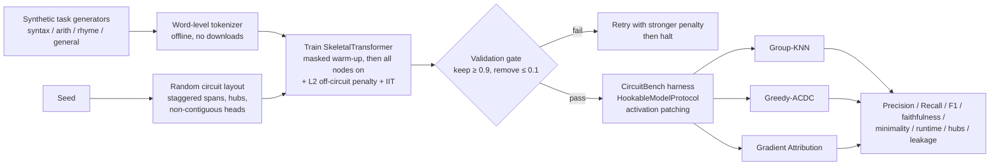
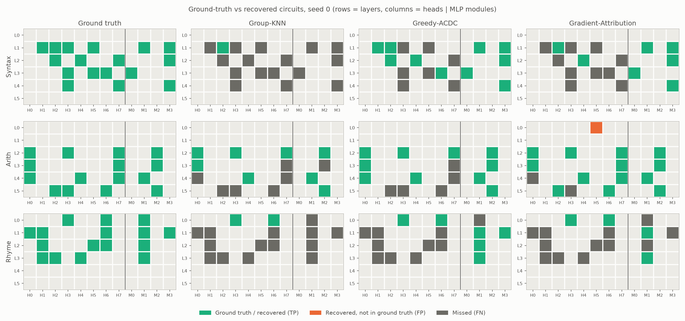

# circuit-bench: a ground-truth benchmark for circuit discovery

Circuit-discovery methods are usually graded on models where nobody knows the true circuit. circuit-bench trains a small transformer with **planted, verified circuits**, so every method's output can be scored as precision and recall against a known answer.

## Problem

Mechanistic-interpretability methods such as ACDC and attribution patching claim to find "the circuit" for a task. On real models there is no answer key: a method that returns a plausible subgraph cannot be distinguished from one that returns the right subgraph. Method comparisons fall back on faithfulness alone, which rewards large circuits and says nothing about whether the recovered nodes are the ones the model actually uses.

## What's missing

Why current evaluation falls short:
- Faithfulness is satisfiable by many different node sets, so it cannot measure identifiability.
- Hand-annotated circuits (IOI, greater-than) are few, partial and only cover one task each.
- Shared ("hub") nodes used by several tasks are rarely tested, even though polysemantic components are the norm.

Why this approach:
- A **skeletal transformer** where every attention head and every MLP module is a separate, addressable node (72 nodes = 6 layers × (8 heads + 4 MLP modules)).
- **Planted circuits per seed**: each task gets a randomized, non-contiguous set of heads and MLPs over a staggered layer span, with 12% of circuit nodes shared between two tasks.
- Training has two phases. First a **masked warm-up**: specialist batches run with off-circuit nodes zeroed, so each planted circuit learns its task. Then **all nodes stay active** with an L2 output penalty on off-circuit nodes plus **interchange-intervention training**: the clean target must survive patching every off-circuit node from the corrupt prompt, and patching the circuit must flip the output to the corrupt target. The full, unmasked model is what gets evaluated. An L2 penalty alone failed the gate in testing, because off-circuit nodes kept carrying the task signal.
- A **hard validation gate**: the planted circuit alone must keep ≥ 0.9 faithfulness and removing it must drop faithfulness to ≤ 0.1, or the run halts.
- Three methods are compared on identical data and identical patching: Group-KNN (proposed), Greedy-ACDC (node-level) and Gradient Attribution.

## Solution



Tasks (all generated locally, minimal clean/corrupt pairs with different single-token targets):
- **Syntax**: subject-verb agreement across a distractor, `the keys near the door` → `are` vs `the key near the door` → `is`.
- **Arithmetic**: `14 + 23 =` → `37` vs `14 + 25 =` → `39` (10 ≤ A, B ≤ 49).
- **Rhyme**: words are split into onset + rime tokens, `rhyme : l ight -> n ight . s ake -> m` → `ake`. Train, val and test use disjoint word pairs (140/30/30).
- **General**: synthetic multi-clause English, trained with next-token loss at 0.2 weight, using all nodes.

The harness only depends on `discovery/protocol.py::HookableModelProtocol` (`node_names`, `node_layers`, and a forward that supports `record` / `patch`), so any PyTorch transformer that implements it can be benchmarked.

## Outcome

Results over seeds [0, 1, 2] on `mps` with 6000 training steps per seed. Values are mean ± std across seeds.

Highest mean F1: **Greedy-ACDC** (0.784). Fastest: **Gradient-Attribution** (0.80s per seed). Best hub recovery: **Greedy-ACDC**. Lowest cross-task leakage: **Group-KNN**. Pareto front on F1 vs runtime: **Greedy-ACDC, Gradient-Attribution**. Group-KNN: mean F1 0.416, runtime 20.00s, 195 forward passes (each pass scores all three tasks at once).

### Method summary

| Method | Mean F1 | Runtime (s) | Forward passes | Hub recovery | Cross-task leakage |
|---|---|---|---|---|---|
| Group-KNN | 0.416 ± 0.088 | 20.00 ± 0.95 | 195 ± 0 | 0.000 ± 0.000 | 0.000 ± 0.000 |
| Greedy-ACDC | 0.784 ± 0.077 | 5.95 ± 0.77 | 219 ± 0 | 0.467 ± 0.306 | 0.000 ± 0.000 |
| Gradient-Attribution | 0.703 ± 0.069 | 0.80 ± 0.20 | 30 ± 3 | 0.133 ± 0.115 | 0.000 ± 0.000 |

### Per-task results

| Method | Task | Precision | Recall | F1 | Faithfulness | Minimality |
|---|---|---|---|---|---|---|
| Group-KNN | Syntax | 1.000 ± 0.000 | 0.108 ± 0.079 | 0.190 ± 0.124 | 0.434 ± 0.279 | 0.981 ± 0.008 |
| Group-KNN | Arith | 1.000 ± 0.000 | 0.511 ± 0.019 | 0.676 ± 0.017 | 0.706 ± 0.046 | 0.898 ± 0.016 |
| Group-KNN | Rhyme | 1.000 ± 0.000 | 0.243 ± 0.122 | 0.381 ± 0.158 | 0.521 ± 0.202 | 0.940 ± 0.035 |
| Greedy-ACDC | Syntax | 1.000 ± 0.000 | 0.574 ± 0.036 | 0.729 ± 0.029 | 1.064 ± 0.052 | 0.889 ± 0.028 |
| Greedy-ACDC | Arith | 1.000 ± 0.000 | 0.708 ± 0.110 | 0.826 ± 0.073 | 0.947 ± 0.021 | 0.861 ± 0.000 |
| Greedy-ACDC | Rhyme | 1.000 ± 0.000 | 0.698 ± 0.282 | 0.798 ± 0.219 | 1.024 ± 0.025 | 0.829 ± 0.079 |
| Gradient-Attribution | Syntax | 1.000 ± 0.000 | 0.404 ± 0.007 | 0.575 ± 0.007 | 0.870 ± 0.012 | 0.921 ± 0.021 |
| Gradient-Attribution | Arith | 0.976 ± 0.041 | 0.810 ± 0.058 | 0.883 ± 0.023 | 0.936 ± 0.064 | 0.833 ± 0.037 |
| Gradient-Attribution | Rhyme | 1.000 ± 0.000 | 0.507 ± 0.228 | 0.651 ± 0.220 | 0.878 ± 0.002 | 0.875 ± 0.064 |

### Ground-truth validation gate (val split)

Each cell shows keep / remove faithfulness, then how many ground-truth nodes individually drop faithfulness by ≥ 0.05.

| Seed | λ_off used | Attempts | Syntax keep / remove | Syntax nodes needed | Arith keep / remove | Arith nodes needed | Rhyme keep / remove | Rhyme nodes needed |
|---|---|---|---|---|---|---|---|---|
| 0 | 0.05 | 1 | 1.149 / -0.000 | 9/17 | 1.001 / 0.000 | 9/15 | 0.995 / -0.001 | 6/16 |
| 1 | 0.05 | 1 | 1.016 / -0.000 | 6/10 | 1.001 / 0.000 | 9/16 | 1.024 / -0.061 | 12/19 |
| 2 | 0.05 | 1 | 1.035 / -0.008 | 5/15 | 1.000 / 0.000 | 9/12 | 1.074 / -0.052 | 11/17 |





## Limitations

- The gate proves the planted set is sufficient and necessary **as a whole**. Individual planted nodes can be redundant (see "nodes needed" above), which caps the recall any node-level method can honestly reach.
- Node-level only: edges between nodes are not scored, so Greedy-ACDC here is a node-level variant of ACDC.
- Group-KNN scores a window by ablating it (patching the window with corrupt activations). Keeping only an 8-node window and corrupting everything else gives near-zero faithfulness for most tasks, because each circuit spans 10+ nodes over several layers.
- Runtime depends on hardware; forward-pass counts are the hardware-independent cost measure.

## Run it

```bash
python -m data.build_datasets
python -m pytest -q
python -m benchmarks.evaluate_identifiability --seeds 0 1 2 --device mps
python -m benchmarks.plot_results
python -m benchmarks.make_readme
```

## Structure

```
configs/      model, training and benchmark settings
data/         offline task generators and tokenizer
model/        SkeletalTransformer (every head and MLP module is a node)
train/        training with the off-circuit L2 penalty
discovery/    HookableModelProtocol, CircuitBench harness, Group-KNN, Greedy-ACDC, Gradient Attribution
benchmarks/   layout generator, gate + evaluation, plots, README builder
tests/        pytest suite
results/      per-seed checkpoints, layouts, gate logs, predictions, benchmark_table.json, figures
```
