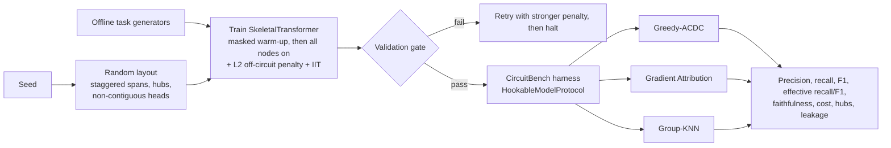
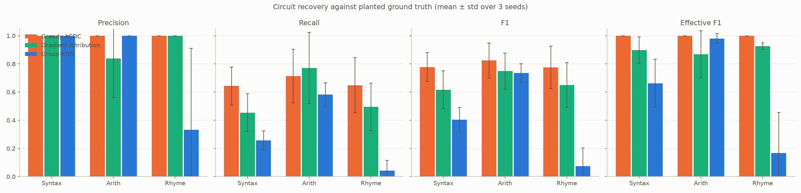
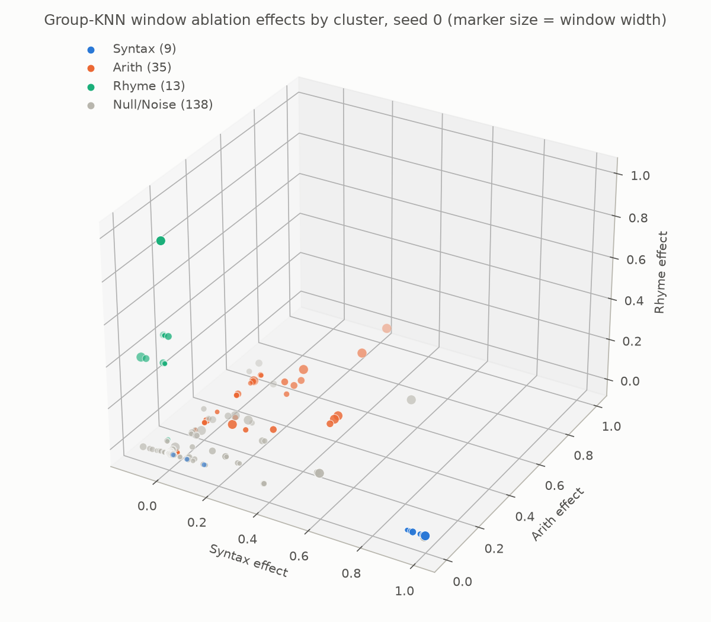

# circuit-bench: a controlled multi-task circuit identifiability benchmark

circuit-bench trains a small transformer in which three tasks run concurrently on planted circuits that share hub nodes, verifies every planted circuit with a hard causal gate, and then scores circuit-discovery methods against that known answer key with precision, recall, F1, faithfulness, minimality and cost.

## Key findings

Seeds [0, 1, 2], `mps`, 6000 training steps per seed, mean ± std across seeds.

1. **Speed vs accuracy.** **Greedy-ACDC** has the highest mean F1 (0.792) and **Gradient-Attribution** is the fastest (0.77s, 34 forward passes per seed). Pareto front on F1 vs runtime: **Greedy-ACDC, Gradient-Attribution**.
2. **Shared polysemantic hubs.** **Greedy-ACDC** recovers the most shared hub nodes in every task that uses them (0.267); see the hub recovery column below for all methods.
3. **Post-IIT circuit compression.** After training, 80 of 137 planted nodes (58%) are individually needed (range 30–76% per task and seed). The rest are redundant slack that a minimal method can legitimately skip, which is why effective recall is reported next to raw recall.

## Problem

Circuit-discovery methods are usually judged on models where nobody knows the true circuit, so faithfulness is the only available score. Many different node sets can be faithful, so faithfulness alone cannot say whether a method found the nodes the model actually uses. A benchmark needs models whose circuits are known and causally verified.

## Benchmark design

- **Skeletal transformer.** Every attention head and every MLP module is a separate, addressable node: 72 nodes = 6 layers × (8 heads + 4 MLP modules), about 4.9M parameters.
- **Tasks**, all generated offline as minimal clean/corrupt pairs with different single-token targets:
  - Syntax: subject-verb agreement across a distractor, `the keys near the door` → `are` vs `the key near the door` → `is`.
  - Arithmetic: `14 + 23 =` → `37` vs `14 + 25 =` → `39` (10 ≤ A, B ≤ 49).
  - Rhyme: words split into onset + rime tokens, `rhyme : l ight -> n ight . s ake -> m` → `ake`. Train, val and test use disjoint word pairs (140/30/30).
  - General: synthetic multi-clause English with next-token loss at 0.2 weight, using all nodes.
- **Randomized layouts per seed.** Each task gets a staggered span of layers and a non-contiguous set of heads plus one MLP module per layer; about 12% of circuit nodes are hubs shared by exactly two tasks.
- **Training.** A masked warm-up (off-circuit nodes zeroed for specialist batches), then all nodes active with an L2 penalty on off-circuit outputs plus interchange-intervention training: patching every off-circuit node from the corrupt prompt must keep the clean answer, and patching the circuit must produce the corrupt answer.
- **Validation gate.** On the validation split, the planted circuit alone must keep faithfulness ≥ 0.9 and removing it must drop faithfulness to ≤ 0.1; otherwise training retries once with a stronger penalty and then halts.
- **Methods.** Greedy-ACDC (node-level, reverse topological, τ = 0.03), Gradient Attribution (attribution patching, smallest top-k reaching 0.85 faithfulness) and Group-KNN (overlapping window ablation, k-means plus k-nearest-neighbour task clustering, recursive binary splitting). All three share one patching harness that depends only on `discovery/protocol.py::HookableModelProtocol`, so any PyTorch transformer that implements it can be benchmarked.
- **Metrics.** Precision is always measured against all planted nodes. Recall and F1 are reported twice: raw (against all planted nodes) and effective (against the individually needed nodes, those whose single ablation drops faithfulness by ≥ 0.05).



## Results

### Method summary

| Method | Mean F1 | Mean effective F1 | Runtime (s) | Forward passes | Hub recovery | Cross-task leakage |
|---|---|---|---|---|---|---|
| Greedy-ACDC | 0.792 ± 0.037 | 1.000 ± 0.000 | 5.67 ± 0.84 | 219 ± 0 | 0.267 ± 0.115 | 0.000 ± 0.000 |
| Gradient-Attribution | 0.672 ± 0.050 | 0.897 ± 0.091 | 0.77 ± 0.13 | 34 ± 10 | 0.067 ± 0.115 | 0.027 ± 0.046 |
| Group-KNN | 0.404 ± 0.068 | 0.603 ± 0.047 | 21.96 ± 4.86 | 195 ± 0 | 0.000 ± 0.000 | 0.000 ± 0.000 |

### Per-task results

| Method | Task | Precision | Recall | F1 | Effective recall | Effective F1 | Faithfulness |
|---|---|---|---|---|---|---|---|
| Greedy-ACDC | Syntax | 1.000 ± 0.000 | 0.644 ± 0.134 | 0.778 ± 0.102 | 1.000 ± 0.000 | 1.000 ± 0.000 | 1.276 ± 0.359 |
| Greedy-ACDC | Arith | 1.000 ± 0.000 | 0.714 ± 0.191 | 0.824 ± 0.124 | 1.000 ± 0.000 | 1.000 ± 0.000 | 0.962 ± 0.022 |
| Greedy-ACDC | Rhyme | 1.000 ± 0.000 | 0.648 ± 0.195 | 0.775 ± 0.151 | 1.000 ± 0.000 | 1.000 ± 0.000 | 0.991 ± 0.007 |
| Gradient-Attribution | Syntax | 1.000 ± 0.000 | 0.454 ± 0.134 | 0.616 ± 0.134 | 0.823 ± 0.159 | 0.898 ± 0.093 | 0.903 ± 0.031 |
| Gradient-Attribution | Arith | 0.839 ± 0.279 | 0.771 ± 0.253 | 0.748 ± 0.129 | 0.952 ± 0.082 | 0.868 ± 0.166 | 0.956 ± 0.051 |
| Gradient-Attribution | Rhyme | 1.000 ± 0.000 | 0.495 ± 0.169 | 0.651 ± 0.158 | 0.863 ± 0.041 | 0.926 ± 0.023 | 0.860 ± 0.008 |
| Group-KNN | Syntax | 1.000 ± 0.000 | 0.256 ± 0.069 | 0.405 ± 0.086 | 0.510 ± 0.184 | 0.662 ± 0.171 | 0.494 ± 0.331 |
| Group-KNN | Arith | 1.000 ± 0.000 | 0.583 ± 0.083 | 0.735 ± 0.067 | 0.963 ± 0.064 | 0.980 ± 0.034 | 0.841 ± 0.111 |
| Group-KNN | Rhyme | 0.333 ± 0.577 | 0.042 ± 0.072 | 0.074 ± 0.128 | 0.111 ± 0.192 | 0.167 ± 0.289 | 0.208 ± 0.360 |

### Validation gate (val split)

Each task shows keep / remove faithfulness, then individually needed nodes / planted nodes.

| Seed | λ_off | Attempts | Syntax keep / remove | Syntax needed | Arith keep / remove | Arith needed | Rhyme keep / remove | Rhyme needed |
|---|---|---|---|---|---|---|---|---|
| 0 | 0.05 | 1 | 1.244 / -0.001 | 13/17 | 1.000 / -0.000 | 9/15 | 0.995 / -0.001 | 6/16 |
| 1 | 0.05 | 1 | 1.000 / -0.000 | 3/10 | 1.000 / 0.000 | 9/16 | 1.052 / -0.011 | 11/19 |
| 2 | 0.05 | 1 | 1.058 / 0.000 | 9/15 | 1.000 / 0.000 | 7/12 | 1.023 / -0.039 | 13/17 |





## Related work

- **Tracr** (Lindner, Kramár, Farquhar, Rahtz, McGrath and Mikulik, 2023, arXiv:2301.05062) compiles human-readable RASP programs into standard decoder-only transformers. The compiled models have known structure, which the authors propose as ground truth for evaluating interpretability methods. Their weights are constructed rather than learned.
- **InterpBench** (Gupta, Arcuschin, Kwa and Garriga-Alonso, NeurIPS 2024 Datasets and Benchmarks) trains 86 semi-synthetic transformers (85 Tracr circuits plus a simplified IOI circuit) with Strict Interchange Intervention Training (SIIT). SIIT also intervenes on components outside the circuit and penalizes any change in the output, so non-circuit components cannot affect it. Each model implements one algorithmic circuit, and the paper evaluates ACDC, Subnetwork Probing, Edgewise SP, Edge Attribution Patching and EAP with integrated gradients at the edge level. Training models with multiple circuits is listed as future work.
- **Relation to circuit-bench.** The training objective here uses the same idea as SIIT: the sufficiency term (patch every off-circuit node from a corrupt prompt and require the clean answer) plays the role of SIIT's strictness loss, and full credit for that idea belongs to InterpBench. The differences are in what is planted and measured:
  - three tasks run concurrently in one model instead of one circuit per model;
  - about 12% of circuit nodes are shared polysemantic hubs used by two tasks, scored with hub recovery and cross-task leakage;
  - layouts are procedurally randomized per seed (staggered layer spans, non-contiguous heads), so results are reported as mean ± std over layouts;
  - post-IIT compression is measured directly: how many planted nodes remain individually needed after training, reported through effective recall and effective F1.

## Limitations

1. **Node-level granularity only.** Heads and MLP modules are scored as nodes; edges between nodes are not scored, so Greedy-ACDC here is a node-level variant of ACDC.
2. **Whole-circuit gate vs individual redundancy.** The gate guarantees that the planted set is sufficient and necessary as a whole. Training then compresses the computation onto a subset of the planted nodes, leaving redundant slack nodes that cap the raw recall any minimal method can reach.
3. **OR-pair nuance in effective recall and effective F1.** `needed_nodes` tests necessity by single-node ablation. Two redundant nodes where either one alone sustains the task both look individually unneeded, so effective recall and effective F1 can flatter a method that recovers only one node of such a pair. Precision stays anchored to all planted nodes to limit this.
4. **Ablation bias in effective metrics.** `needed_nodes` is defined by a single-node ablation drop of at least 0.05, and Greedy-ACDC keeps a node when its removal drops faithfulness by at least 0.03. Effective recall and effective F1 therefore partly share ACDC's own selection criterion and favour ablation-based methods; raw recall and raw F1 do not have this bias.

## Run it

```bash
uv sync
uv run python -m data.build_datasets
uv run pytest -q
uv run python -m benchmarks.evaluate_identifiability --seeds 0 1 2 --device mps
uv run python -m benchmarks.plot_results
uv run python -m benchmarks.make_readme
```

Quality checks run in CI on every push and pull request: `ruff format --check`, `ruff check`, `pyright` (strict) and `pytest`.

## Structure

```
configs/      model, training and benchmark settings
data/         offline task generators and tokenizer
model/        SkeletalTransformer (every head and MLP module is a node)
train/        masked warm-up, L2 off-circuit penalty and interchange-intervention training
discovery/    HookableModelProtocol, CircuitBench harness, Greedy-ACDC, Gradient Attribution, Group-KNN
benchmarks/   layout generator, gate and evaluation, plots, README builder
typings/      local type stubs for scikit-learn
tests/        pytest suite, including a no-comments check
results/      per-seed layouts, gate logs, predictions, benchmark_table.json and figures
```

## License

MIT
